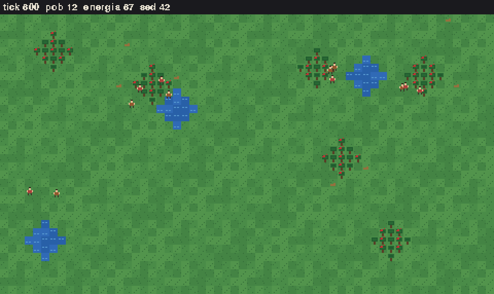

# 🏹 Tribal


> Una banda de homínidos despierta en un mundo hostil sin nada y, generación tras generación, **la civilización aparece sola**.

Este repositorio construye una simulación en **2D pixel-art** donde 8–15 agentes con necesidades, memoria y personalidad viven en tiempo real, y donde la **cultura** (herramientas, fuego, lenguaje, rituales, mitos) emerge de su dinámica y no de un guion. Los LLM locales actúan como cerebros individuales **solo cuando hay algo real que decidir**.

El objetivo no es dibujar una tribu: es un experimento observable sobre cómo nace la cultura sin que nadie la escriba.

## Documentación

| Documento | Contenido |
|---|---|
| [`vault/01_PROYECTO/concepto.md`](vault/01_PROYECTO/concepto.md) | Concepto principal: agentes, memoria, evolución, espontaneidad, riesgos y fases |
| [`vault/01_PROYECTO/stack-tecnologico.md`](vault/01_PROYECTO/stack-tecnologico.md) | Stack y el porqué de cada decisión técnica |
| [`vault/01_PROYECTO/objetivo.md`](vault/01_PROYECTO/objetivo.md) | Objetivo: problema, usuario, criterio de hecho medible y fuera de alcance |
| [`vault/01_PROYECTO/arquitectura.md`](vault/01_PROYECTO/arquitectura.md) | Plan técnico — lo escribe la feature `DESIGN-001` |

## Criterio de éxito

La tribu pasa de **cero** a **fuego + una herramienta compuesta + proto-lenguaje + un mito**, y **al menos la mitad de esos nodos no estaban en el árbol de plausibilidad inicial**. Todo lo demás (escala, gráficos, duración) está al servicio de ese momento. El KPI exacto y la consulta que lo comprueba están en [`objetivo.md`](vault/01_PROYECTO/objetivo.md#3-criterio-de-hecho).

## Flujo de trabajo: spec → plan → tareas

| Paso | Feature | Produce |
|---|---|---|
| **Spec** (qué se resuelve) | `SCOPE-001` | `vault/01_PROYECTO/objetivo.md` |
| **Plan** (cómo se resuelve) | `DESIGN-001` | `vault/01_PROYECTO/arquitectura.md` |
| **Tareas** | `CORE-001`, `QA-001`, … | `harness/featureslist.json` |

Ninguna feature se cierra sin que `./init.sh` pase en verde. El protocolo completo está en [`AGENTS.md`](AGENTS.md).

## Inicio rápido

```bash
make setup     # uv sync + hooks
make init      # la puerta: ¿se puede trabajar?
make run       # ejecuta el paquete
make check     # lint + typecheck + test + arnés
```

## Ejecutar (Fase 0)

La Fase 0 es una tribu de 8–15 individuos en un mapa top-down de 60×34 tiles
(480×272 px) con tres necesidades —energía, sed y salud— que evolucionan por
tick. Cada individuo nace con un **genoma mínimo** (velocidad y metabolismo)
que modula cuánto avanza por tick y cuánto gasta; la herencia y la mutación
llegan en la Fase 1. Se mueven, beben en los lagos, comen bayas o caza y
descansan siguiendo reglas locales; si no cubren una necesidad, enferman y
mueren. Todavía **no** hay cultura ni LLM: eso son fases posteriores.

```bash
uv run python -m tribal run                                      # ventana 60 fps, 12 individuos
uv run python -m tribal run --headless --ticks 600 --json        # una partida, resumen JSON
uv run python -m tribal run --seed 7 --benchmark --headless --ticks 600
```



En la ventana se ve el mapa (hierba, lagos azules, bosques con bayas rojas y
caza marrón), los individuos como sprites de 6×8 px (túnica ocre o roja según
sexo) y una franja de HUD con tick, población y media de energía y sed.
**ESC** o cerrar la ventana termina la partida.

Salida real de `uv run python -m tribal run --headless --ticks 600 --json`:

```json
{"seed": 42, "ticks": 600, "poblacion_inicial": 12, "poblacion_final": 12, "nacimientos": 0, "muertes": 0, "media_energia": 66.62, "media_sed": 42.32, "individuos_movidos": 12}
```

`--seed 7 --benchmark --headless --ticks 600` (comprueba el presupuesto de
16,67 ms/tick; sale con código != 0 si no cabe):

```
seed 7  ticks 600  poblacion 12 -> 12
muertes 0  nacimientos 0  individuos movidos 12
media energia 40.85  media sed 38.25
```

y en **stderr** (el `ms/tick` no entra en el resumen, que es determinista; su
valor varía unas centésimas entre ejecuciones):

```
benchmark: 0.24 ms/tick, cabe en 16.67 ms
```

Opciones de `run`: `--seed` (default 42), `--individuos` (8–15, default 12),
`--ticks` (`0` = sin límite en ventana; obligatorio > 0 con `--headless`),
`--headless`, `--json` y `--benchmark`.

Una partida más larga enseña el coste de no cubrir una necesidad:
`uv run python -m tribal run --seed 2 --headless --json --ticks 3000` acaba con
`poblacion_final: 11` y `muertes: 1` (sed al 100 lejos del agua). Sin ningún
recurso la tribu se extingue; ese caso lo cubren los tests del motor.

## Principios

1. **La magia es la sorpresa de la dinámica, no el contenido.** El LLM hace legible la emergencia; no la fabrica. Se constriñe la coherencia, nunca la dirección.
2. **Complejidad cuando la ganes.** Python + Pygame + SQLite; sin Mongo, Docker ni Rust hasta que aporten algo.
3. **El cuello de botella manda.** Se optimiza para la inferencia del LLM, no para la CPU.
4. **Capas desacopladas.** Motor de reglas, genética, memoria y LLM son piezas intercambiables.
5. **Observar es el producto.** El grafo de cultura (Obsidian y, en su día, D3) es la ventana al sistema, no un extra.

## Fases

| Fase | Qué añade | Puerta de salida |
|---|---|---|
| **0** | Motor de reglas continuo + 2D, sin LLM | La tribu vive y muestra comportamiento emergente de las puras reglas |
| **1** | Genoma + habilidades + árbol de conocimiento | Descubre algo no trivial **sin** LLM |
| **2** | Capa LLM por saliencia + diálogo + narración | Propone nodos fuera del árbol a ritmo no trivial |
| **3** | Memoria colectiva + transmisión + roles emergentes | Fin de película: criterio de éxito |

## Estructura

```
tribal/                 ← código de Tribal (motor, agentes, capa LLM)
tests/                  ← tests
agents/                 ← arnés de build (24 agentes Python)
harness/                ← backlog y memoria del arnés
vault/                  ← conocimiento del proyecto (Obsidian)
AGENTS.md               ← protocolo del arnés
init.sh                 ← la puerta
```
