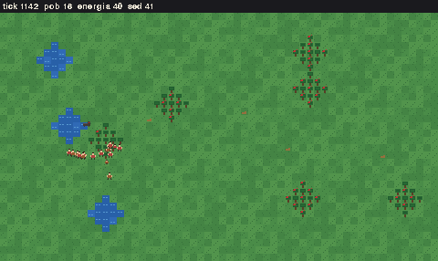

# 🏹 Tribal


> Una banda de homínidos despierta en un mundo hostil sin nada y, generación tras generación, **la civilización aparece sola**.

Este repositorio construye una simulación en **2D pixel-art** donde 8–15 agentes con necesidades, memoria y personalidad viven en tiempo real, y donde la **cultura** (herramientas, fuego, lenguaje, rituales, mitos) emerge de su dinámica y no de un guion. Los LLM locales actúan como cerebros individuales **solo cuando hay algo real que decidir**.

El objetivo no es dibujar una tribu: es un experimento observable sobre cómo nace la cultura sin que nadie la escriba.

## Documentación

| Documento | Contenido |
|---|---|
| [`vault/01_PROYECTO/concepto.md`](vault/01_PROYECTO/concepto.md) | Concepto principal: agentes, memoria, evolución, espontaneidad, riesgos y fases |
| [`vault/01_PROYECTO/stack-tecnologico.md`](vault/01_PROYECTO/stack-tecnologico.md) | Stack y el porqué de cada decisión técnica |
| [`vault/01_PROYECTO/objetivo.md`](vault/01_PROYECTO/objetivo.md) | Objetivo: problema, usuario, criterio de hecho medible y fuera de alcance |
| [`vault/01_PROYECTO/arquitectura.md`](vault/01_PROYECTO/arquitectura.md) | Plan técnico — lo escribe la feature `DESIGN-001` |

## Criterio de éxito

La tribu pasa de **cero** a **fuego + una herramienta compuesta + proto-lenguaje + un mito**, y **al menos la mitad de esos nodos no estaban en el árbol de plausibilidad inicial**. Todo lo demás (escala, gráficos, duración) está al servicio de ese momento. El KPI exacto y la consulta que lo comprueba están en [`objetivo.md`](vault/01_PROYECTO/objetivo.md#3-criterio-de-hecho).

## Flujo de trabajo: spec → plan → tareas

| Paso | Feature | Produce |
|---|---|---|
| **Spec** (qué se resuelve) | `SCOPE-001` | `vault/01_PROYECTO/objetivo.md` |
| **Plan** (cómo se resuelve) | `DESIGN-001` | `vault/01_PROYECTO/arquitectura.md` |
| **Tareas** | `CORE-001`, `QA-001`, … | `harness/featureslist.json` |

Ninguna feature se cierra sin que `./init.sh` pase en verde. El protocolo completo está en [`AGENTS.md`](AGENTS.md).

## Inicio rápido

```bash
make setup     # uv sync + hooks
make init      # la puerta: ¿se puede trabajar?
make run       # ejecuta el paquete
make check     # lint + typecheck + test + arnés
```

## Ejecutar (Fase 0)

La Fase 0 es una tribu de 8–15 individuos en un mapa top-down de 60×34 tiles
(480×272 px) con tres necesidades —energía, sed y salud— que evolucionan por
tick. Cada individuo nace con un **genoma mínimo** (velocidad, metabolismo y
longevidad) que modula cuánto avanza, cuánto gasta y cuánto vive. Las parejas
adultas y bien alimentadas tienen crías junto al agua, que heredan la media de
sus progenitores con una mutación pequeña; con la edad llega la muerte. Un
**depredador** recorre el mapa, persigue a la presa viva más cercana y la
muerde: quien lo ve cerca huye en un sprint. De ahí salen dos comportamientos
que nadie guioniza —la tribu se agolpa en los lagos y huye en manada— y que la
puerta F0→F1 mide. Todavía **no** hay cultura ni LLM: eso son fases posteriores.

```bash
uv run python -m tribal run                                      # ventana 60 fps, 12 individuos
uv run python -m tribal run --headless --ticks 600 --json        # una partida, resumen JSON
uv run python -m tribal run --seed 7 --benchmark --headless --ticks 600
```



En la ventana se ve el mapa (hierba, lagos azules, bosques con bayas rojas y
caza marrón), los individuos como sprites de 6×8 px (túnica ocre o roja según
sexo, más pequeños mientras son crías), el depredador como un cuadrúpedo oscuro
con ojo rojo y una franja de HUD con tick, población y media de energía y sed.
**ESC** o cerrar la ventana termina la partida.

Salida real de `uv run python -m tribal run --headless --ticks 600 --json`:

```json
{"seed": 42, "ticks": 600, "poblacion_inicial": 12, "poblacion_final": 12, "nacimientos": 1, "muertes": 1, "media_energia": 43.55, "media_sed": 38.88, "individuos_movidos": 13, "depredador": {"activos": 1, "ataques": 4, "muertes": 1}, "agrupamiento_max": 6, "huidas": 49, "config": {"seed": 42, "individuos": 12, "ancho": 60, "alto": 34, "tasa_sed": 0.16, "tasa_energia": 0.15, "tasa_salud": 0.6, "cooldown_reproduccion": 600, "depredadores": 1, "depredador_activo": true}}
```

`--seed 7 --benchmark --headless --ticks 600` (comprueba el presupuesto de
16,67 ms/tick; sale con código != 0 si no cabe):

```
seed 7  ticks 600  poblacion 12 -> 13
muertes 0  nacimientos 1  individuos movidos 13
depredadores 1  ataques 2  agrupamiento max 11  huidas 150
media energia 50.53  media sed 29.6
```

y en **stderr** (el `ms/tick` no entra en el resumen, que es determinista; su
valor varía unas centésimas entre ejecuciones):

```
benchmark: 0.24 ms/tick, cabe en 16.67 ms
```

Opciones de `run`: `--seed` (default 42), `--individuos` (8–15, default 12),
`--config` (fichero JSON), `--ticks` (`0` = sin límite en ventana; obligatorio
> 0 con `--headless`), `--headless`, `--json` y `--benchmark`.

## Configuración y semilla

Una partida se reproduce con **semilla + configuración**: la semilla fija el
azar del mundo y la configuración fija todo lo demás (población, tamaño del
mapa y tasas de desgaste). `SimConfig` (`tribal/config.py`) reúne esos
parámetros, es inmutable y se serializa a JSON; el resumen de la partida los
incluye en su campo `config`, así que una salida inesperada se puede volver a
ejecutar en vez de solo anotarse.

El fichero de ejemplo, commiteado como [`docs/config-ejemplo.json`](docs/config-ejemplo.json),
es exactamente una partida por defecto:

```json
{
  "seed": 42,
  "individuos": 12,
  "ancho": 60,
  "alto": 34,
  "tasa_sed": 0.16,
  "tasa_energia": 0.15,
  "tasa_salud": 0.6,
  "cooldown_reproduccion": 600,
  "depredadores": 1,
  "depredador_activo": true
}
```

```bash
uv run python -m tribal run --headless --config docs/config-ejemplo.json --json --ticks 600
```

Las claves que falten toman su default. Es **error** —código 2, mensaje con la
clave y el valor, sin traza— una clave desconocida, `individuos` fuera de
8–15, un mapa menor que 9×9 tiles, una tasa o un `cooldown_reproduccion` ≤ 0,
un `depredadores` negativo, un `depredador_activo` que no sea booleano o un
valor de tipo equivocado (`"ancho": 60.7`, `"seed": "hola"`,
`"individuos": true`).

Precedencia: **CLI > fichero > defaults**. `--seed` y `--individuos` pasados a
mano mandan sobre el fichero (y el resumen refleja los valores efectivos):

```bash
uv run python -m tribal run --headless --config docs/config-ejemplo.json --seed 7 --individuos 9 --json --ticks 30
# ... "seed": 7, "poblacion_inicial": 9, "config": {"seed": 7, "individuos": 9, ...}
```

Una partida más larga enseña la puerta F0→F1 completa:
`uv run python -m tribal run --seed 2 --headless --json --ticks 3000` acaba
con `poblacion_final: 10`, `nacimientos: 10`, `muertes: 12` (3 de ellas por
mordiscos del depredador), 8 ataques, `huidas: 3688` y un
`agrupamiento_max: 11`: once individuos a ≤2 tiles de un lago en el mismo tick
(no necesariamente bebiendo a la vez). Sin ningún recurso la tribu se extingue;
ese caso lo cubren los tests del motor.

## Principios

1. **La magia es la sorpresa de la dinámica, no el contenido.** El LLM hace legible la emergencia; no la fabrica. Se constriñe la coherencia, nunca la dirección.
2. **Complejidad cuando la ganes.** Python + Pygame + SQLite; sin Mongo, Docker ni Rust hasta que aporten algo.
3. **El cuello de botella manda.** Se optimiza para la inferencia del LLM, no para la CPU.
4. **Capas desacopladas.** Motor de reglas, genética, memoria y LLM son piezas intercambiables.
5. **Observar es el producto.** El grafo de cultura (Obsidian y, en su día, D3) es la ventana al sistema, no un extra.

## Fases

| Fase | Qué añade | Puerta de salida |
|---|---|---|
| **0** | Motor de reglas continuo + 2D, sin LLM | La tribu vive y muestra comportamiento emergente de las puras reglas |
| **1** | Genoma + habilidades + árbol de conocimiento | Descubre algo no trivial **sin** LLM |
| **2** | Capa LLM por saliencia + diálogo + narración | Propone nodos fuera del árbol a ritmo no trivial |
| **3** | Memoria colectiva + transmisión + roles emergentes | Fin de película: criterio de éxito |

## Estructura

```
tribal/                 ← código de Tribal (motor, agentes, capa LLM)
tests/                  ← tests
agents/                 ← arnés de build (24 agentes Python)
harness/                ← backlog y memoria del arnés
vault/                  ← conocimiento del proyecto (Obsidian)
AGENTS.md               ← protocolo del arnés
init.sh                 ← la puerta
```
