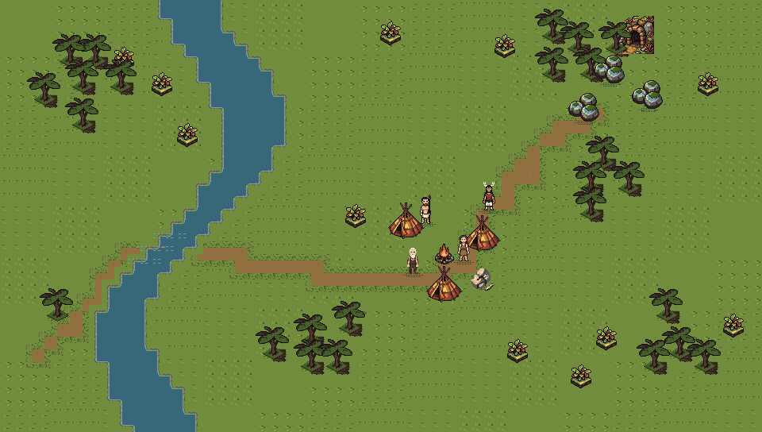
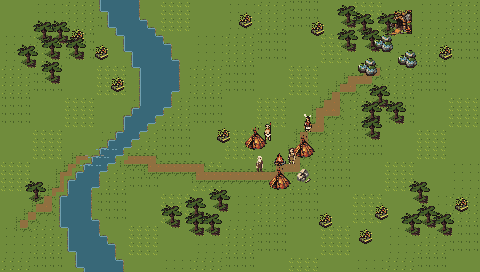
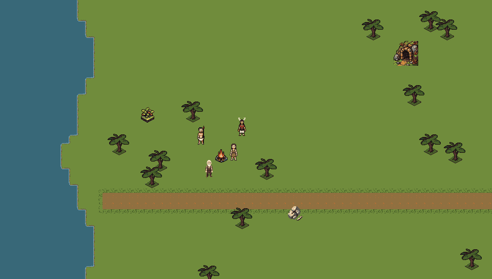
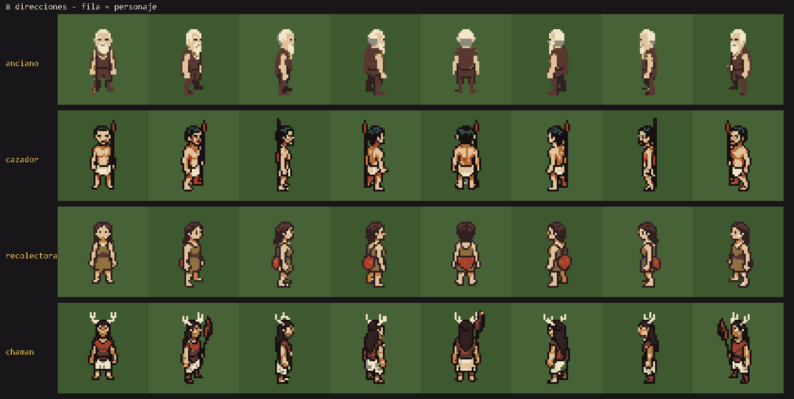
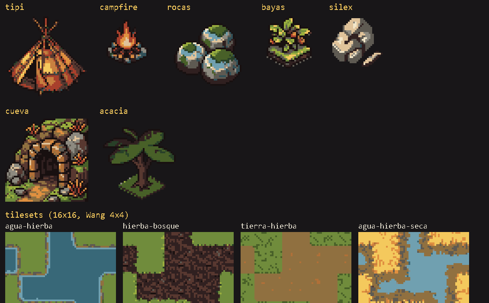
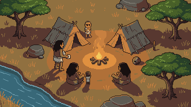

# Arte de Tribal — kit mínimo generado con PixelLab

> Sesión de trabajo del **2026-11-19**. Todo lo descrito aquí vive en `docs/art/`.
> **No se ha modificado código de producto**: `tribal/`, `harness/`, `tests/` y
> `vault/` están exactamente como los dejó quien estuviera trabajando en F2-004.
> Los únicos cambios en el repo son ficheros nuevos bajo `docs/art/`.

---

## 1. Qué se ha analizado: la idea

El proyecto es **Tribal**: una banda de 8–15 homínidos prehistóricos simulada en
2D top-down, donde el LLM local solo decide cuando hay un dilema real y la
cultura (fuego, lítica, proto-lenguaje, mitos) tiene que **emerger** sin que
nadie la escriba (`vault/01_PROYECTO/objetivo.md`, §1 y §3).

De ahí salen cuatro restricciones que mandan sobre el arte, y no al revés:

| Restricción del proyecto | Consecuencia para el arte |
|---|---|
| "El apartado gráfico **no es el producto**" (objetivo §4.5) | Kit pequeño y barato, no una demo de arte. Siete props y cuatro personas bastan. |
| El observador **mira**, no juega (concepto §1b) | Lo que hay que leer de un vistazo es **quién es quién** y **dónde está el agua / el fuego**. Nada de detalle que no se distinga a tamaño real. |
| Roles emergentes: cazador, recolectora, anciano, chamán (concepto §8) | Cuatro siluetas distintas por **forma**, no solo por color. |
| Ventana actual: 60×34 tiles de **8 px** = 480×286 (272 de mapa + 14 de HUD, `tribal/core/modelos.py`) | El kit se diseña a **16 px nativo** y se entrega también a 8 px, porque subir `TILE_PX` es tocar producto. |

La conclusión de diseño, por tanto, no es "hacer pixel art bonito" sino **hacer
legible una aldea de 12 personas en 480×272 píxeles de mapa**.

---

## 2. Auditoría de la skill `omer-metin/skills-for-antigravity@pixel-art-sprites`

Antes de instalarla se revisó lo que se iba a ejecutar. Resumen:

| Comprobación | Resultado |
|---|---|
| Repo | `github.com/omer-metin/skills-for-antigravity`, público, **Apache-2.0**, 218★, 31 forks |
| Último push | 2026-01-22 (repo congelado, sin commits posteriores) |
| Contenido de la skill | **4 ficheros Markdown, 38 931 bytes**. Cero scripts, cero binarios, cero dependencias |
| Búsqueda de patrones peligrosos (`curl`, `wget`, `rm -rf`, `eval`, `exec`, `powershell`, `.env`, `ssh`, `api_key`, URLs) | **0 coincidencias** en los cuatro ficheros |
| ¿Ejecuta algo? | No. Es texto: rol, patrones, anti-patrones y validaciones |
| ¿Pide credenciales o red? | No |

SHA-256 de lo descargado (para poder repetir la auditoría):

```
6619C471652C15B240F16935F3FDDAA7BE1CEBE39F516D73FA3733931D172918  SKILL.md
9C80A1E8B7C34D73627FC4567C39DC9DF13E125259B96E052E2277AAC2830EDD  references/patterns.md
7D1BC4B6B67C71F018346DD9B1F475288AE37DBA5229B12419E7C7745F7CA849  references/sharp_edges.md
54AAD5B31FB6F5ED2B198226568736AABB3F231069D49E255847EB816AC13F72  references/validations.md
```

**Veredicto: segura de instalar y de usar.** Es documentación, y una skill
Markdown no puede hacer nada por sí sola salvo influir en el prompt; el riesgo
real sería una inyección de instrucciones, y no hay ninguna.

### Cómo se usó (reglas que sí cambiaron el resultado)

De `references/patterns.md`:

- **Diseñar a 1×, no a zoom.** "If you can't tell what it is at 1x zoom, the
  sprite has failed" → los personajes se revisaron a 32 px reales, no ampliados.
- **Silueta primero.** El chamán se distingue por las astas, el anciano por el
  bastón y la barba, la recolectora por el cesto: formas, no tintes.
- **Paleta corta + hue shifting**, nunca "más sombra = más negro".
- **Sin antialias**; bordes duros y transparencia total.
- **Tiles que casan**: set Wang por esquinas en vez de un tile decorativo suelto.

De `references/sharp_edges.md`:

- **Escalado no entero destruye el pixel art** → todos los reescalados del kit
  son ×2 / ÷2 exactos, nunca 1,5×.
- **Pillow shading** (oscurecer solo el borde) → luz fija arriba-izquierda.
- **Explosión de colores** → cuantización obligatoria a la paleta cerrada.

De `references/validations.md`: se usó como checklist de "esto debe ser cierto"
(pixelArt/crisp, escalas enteras, hojas con tamaño de frame declarado).

### Instalación y borrado

- Se instaló **fuera del repo**, en `%TEMP%\opencode\skills-audit\pixel-art-sprites\`
  (4 ficheros), para no meter nada en el árbol de trabajo.
- Se borró al terminar. Verificado: el directorio ya no existe.
- Además, el arranque de la sesión había dejado una copia en
  `C:\Users\pedro\.agents\skills\pixel-art-sprites` (creada hoy a las 09:56,
  mismo contenido y mismos hashes). **También se borró**, y el propio arnés lo
  confirmó retirando la skill del catálogo. Quedan solo `caveman*`,
  `find-skills` y `graphify` en `.agents/skills/`.
- Restaurarla es volver a bajar esos 4 ficheros del repo Apache-2.0.

### Segunda pasada (rediseño del mapa)

Para el rediseño del mapa se volvió a instalar y se volvió a borrar. Los hashes
son idénticos a los de la tabla de arriba — es el mismo contenido, sin cambios
en el repo de origen — y la copia temporal (`%TEMP%\opencode\skills-audit\`)
se eliminó al terminar, con `Test-Path` en falso.

---

## 3. Diseño

### 3.1 Rejilla y escala

| Decisión | Valor | Motivo |
|---|---|---|
| Rejilla nativa del kit | **16×16 px** | Es donde PixelLab entrega calidad y donde una silueta humana de 32 px cabe con proporciones 3/4. |
| Variante de compatibilidad | **8×8 px** (`kit-8px/`) | El juego hoy usa `TILE_PX = 8`; el kit se entrega ya dividido a la mitad para no tocar código. |
| Personaje | 48×48 de lienzo, figura de ~32 px | 2 tiles de alto a 16 px; a 8 px queda en 16 px = 2 tiles, misma proporción. |
| Vista | top-down 3/4 (`low top-down`) | Coherente con el render actual y con la cámara del concepto. |
| Escalado en pantalla | solo entero (×2, ×3) | Regla de la skill; `pygame.transform.scale` con factor entero. |

### 3.2 Paleta — "Paleolítico 20"

Extraída de la keyart (`raw/props/keyart-campamento.png`), contrastada con los
colores que ya usa `tribal/ui/render.py` y cerrada a 20 tonos
(`palette.json`).

| Rol | Hex | Uso |
|---|---|---|
| ink | `#181010` | contorno y huecos |
| shadow | `#302020` | sombra de tierra y pelo |
| bark | `#583830` | troncos, cuero oscuro |
| hide | `#907040` | piel curtida, ramas secas |
| tan | `#b07038` | tierra batida, cuerpos |
| sand | `#c88040` | sabana seca, arena |
| bone | `#e0c39a` | piel, hueso, roca clara |
| bone-light | `#f2e6c9` | brillo de piel y hueso |
| forest | `#284028` | copa de árbol |
| grass-dark | `#486028` | hierba en sombra |
| grass-light | `#708c3c` | hierba iluminada |
| leaf | `#9aae3e` | matorral, hoja joven |
| water-dark | `#305058` | agua profunda |
| water | `#386878` | agua |
| water-light | `#70a0b0` | orilla y reflejos |
| stone-dark | `#5e5a52` | pedernal, roca en sombra |
| stone | `#8d8a80` | roca, ceniza, pelo cano |
| red-earth | `#a8402c` | ocre rojo, bayas, sangre |
| ember | `#e09040` | brasa |
| fire-light | `#f4c95d` | llama y chispa |

Los dos grises y el `leaf` se añadieron **por evidencia**: sin ellos, el pelo
cano del anciano y el sílex salían azules, y el matorral de bayas salía amarillo
(la cuantización a "color más cercano" no entiende de tono). Con 20 se arregló.

### 3.3 Reglas de estilo

1. Todo pixel opaco pertenece a la paleta. **Verificado: 0 píxeles fuera** sobre
   110 222 píxeles opacos.
2. Sin antialias: transparencia total o color de paleta.
3. Contorno siempre `ink`, nunca "el material un poco más oscuro".
4. Luz fija arriba-izquierda; sombra abajo-derecha.
5. Escalado solo entero.

### 3.4 Qué hay y qué no

| Sí (hecho) | No (deferido, con motivo) |
|---|---|
| 4 personajes × 8 direcciones | Animaciones (cuestan 1 generación **por dirección**) |
| 4 tilesets Wang de 16 tiles: agua/hierba, **hierba/bosque**, tierra/hierba, agua/hierba seca | Terraza de roca (la cueva se resuelve con props de roca) |
| 7 props: hoguera, **tipi**, **rocas**, bayas, sílex, cueva, acacia | Lanzas sueltas, fauna, iconos de UI |
| 1 keyart de referencia (384×216) | Variantes de sexo/edad de cada rol |
| **6 variantes de hierba** generadas localmente (0 generaciones) | Animación de agua (2–3 frames de oleaje) |

---

## 4. Proceso con el MCP de PixelLab

Cuenta en plan **trial**: 40 generaciones, **1 job concurrente**. Todo se hizo en
serie por eso, y por eso los tiempos son los que son.

### 4.1 Llamadas

Personajes (`create_character`, `mode="standard"` → 1 generación a cualquier
tamaño, 8 direcciones, `size=32`, `view="low top-down"`, `shading="flat"`,
`detail="low detail"`, `outline="single color black outline"`):

| Personaje | Descripción enviada |
|---|---|
| Anciano | elderly paleolithic man, long grey beard, bald top, leaning on a wooden walking stick, bone necklace, hide cloak |
| Cazador | paleolithic hunter, lean adult man, bare chest with ochre red paint stripes, fur loincloth, holding a long wooden spear, short dark hair, no beard |
| Recolectora | paleolithic woman gatherer, simple hide tunic, woven basket on her back, brown hair tied back, barefoot |
| Chamán | paleolithic shaman, antler headdress, painted face, fur cloak, holding a tall staff with feathers |

Tilesets (`create_topdown_tileset`, `mode="standard"`, 16 px, `transition_size=0`,
`shape_style="square"`): 1 generación y 16 tiles cada uno.

| Set | lower → upper | `raggedness` | Veredicto |
|---|---|---|---|
| `agua-hierba` | deep blue river water with small white ripples → green grass | 0.45 | **elegido** (con `enhance=false`) |
| `tierra-hierba` | packed dirt trail → lush green savanna grass | 0.50 | **elegido** |
| `agua-hierba-seca` | shallow river water, muddy banks → dry savanna grass | 0.40 | se queda como variante de estación seca |

Props (`create_image_pixen`, 1 generación, fondo transparente, `high top-down`):

| Asset | Descripción |
|---|---|
| Hoguera | small campfire with a ring of grey stones, three crossed logs and bright orange flames |
| Bayas | low green shrub with clusters of small red berries |
| Sílex | grey flint stone nodule with chipped sharp facets… (2ª versión: "plain medium grey and dark grey tones only, no purple, no blue") |
| Cueva | cave entrance in a rocky hillside, dark arched opening with stone lintel |
| Acacia | single acacia tree with a wide flat canopy seen from directly above |

Keyart (`create_image_pixen`, 384×216, sin transparencia): la aldea al
atardecer, que sirve de referencia de tono para todo lo demás.

### 4.1b Segunda pasada: el mapa

El mapa de la primera versión era lo más flojo del kit: una sola pieza de
hierba repetida, un río con forma de banda y árboles espolvoreados al azar.
Estas son las cinco generaciones que se dedicaron a arreglarlo.

| # | Llamada | Parámetros | Id | Veredicto |
|---|---|---|---|---|
| 1 | `create_topdown_tileset` | lower "dark forest floor, damp brown soil with fallen leaves and thin exposed roots" → upper "green savanna grass"; 16 px, `raggedness 0.55` | `d4bfc078-87a4-4057-978b-5ebf3c8e92f4` | **elegido**: es el suelo de bosque que faltaba |
| 2 | `create_topdown_tileset` | "deep blue river water with soft white foam ripples in the middle of the tile" → "green savanna grass"; `raggedness 0.6` | `7a7b2c5b-c52f-438c-a284-a8878af7a7d0` | **rechazado**: hierba amarilla y un borde rojo en la orilla |
| 3 | `create_image_pixen` | tipi de pieles, postes cruzados, 48×48, `high top-down` | `e7a2203b-83a4-4288-8615-5ff4d5e46505` | **elegido** |
| 4 | `create_image_pixen` | tres rocas grises con musgo, 48×48, sin púrpura ni azul | `aff16b25-704e-46e7-9065-efdac665bc55` | **elegido** |
| 5 | `create_topdown_tileset` | "dry golden savanna grass" → "green savanna grass" | `1699551a-9dda-4517-bdc2-cf8a602b3a36` | **rechazado**: el verde de arriba no es el del resto del kit; los dos tonos cálidos no casan |

Los dos rechazos son coste hundido: 2 de las 5 generaciones. La variación de
hierba que se buscaba con el #5 se resolvió **sin gastar**: seis variantes
locales del tile base, con matas de 3–4 px en colores de la paleta y sin tocar
el borde de 1 px, que es lo que rompe las costuras.

### 4.2 Coste real

| | |
|---|---|
| Generaciones al empezar | 40 |
| Generaciones usadas | **21** |
| Restantes | 19 |
| Desglose | 16 de la primera pasada + 5 del rediseño del mapa (2 rechazadas) |

Un envío que falla no se cobra; un resultado malo **sí** (y hay que rehacerlo).
El tileset de "lush green savanna grass" salió con hierba neón y agua marrón y se
descartó: coste hundido de 1 generación. Igual pasó con el primer sílex, que salió
lila, y con los dos tilesets de la segunda pasada (hierba amarilla y verde
desafinado).

### 4.3 Incidencias que conviene saber

1. **El servidor MCP se cayó dos veces** (`Connection closed`, namespace
   desaparecido del catálogo). Los jobs sobreviven en el servidor: al reconectar,
   `get_image`/`get_character` devolvieron el trabajo intacto. Recomendable
   envolver las llamadas en reintento.
2. **Plan trial = 1 generación a la vez.** Lanzar 4 personajes en paralelo
   devuelve `rate limit exceeded — max concurrent jobs reached`; hay que
   serializar.
3. **`palette` solo funciona en `mode="pro"`** de `create_character`. La paleta
   se aplica después, cuantizando (gratis, local).
4. **`tile_size` exige objeto** (`{"width":16,"height":16}`), no un entero.
5. **`enhance=true` reescribe tus prompts** y se lleva por delante las palabras
   de color: con `enhance=false` el agua salió azul a la primera.

---

## 5. Resultado

### 5.1 La aldea a 16 px (960×544, 60×34 tiles)



### 5.2 La misma escena a 8 px (480×272, el tamaño real del mapa de hoy)



### 5.3 Rediseño del mapa: antes y después

La primera versión del mapa era lo más flojo del kit. Esto es lo que cambió:

| Antes | Ahora | Por qué |
|---|---|---|
| Una sola pieza de hierba repetida en toda la sabana | **6 variantes** en manchas de 4×4 tiles | La repetición se veía como una textura muerta; las variantes no tocan el borde de 1 px, así que no abren costuras |
| Río con forma de banda vertical | **Meandro** por spline (Catmull-Rom) con cauce que se ensancha y se estrecha | Una banda recta no parece un río |
| Sin forma de cruzar | **Vado** con el cauce estrechado, corrientes cortas y tres piedras de paso | El sendero ahora tiene a dónde ir y el río deja de ser una frontera |
| Árboles espolvoreados (1,1 % por celda) | **Manchas de bosque** con separación mínima de 2 tiles, y suelo de bosque solo bajo cada copa | El ruido uniforme no se lee como bosque; el marrón suelto se leía como una mancha de tierra |
| Sendero recto de 2 tiles | Sendero **curvo de 1 tile** (se ensancha cada 5 pasos) que cruza el vado y sube a la cueva | El recto partía el mapa en dos |
| Aldea sin refugio | **Tres tipis** alrededor del fuego | Cuatro personas y una hoguera no son una aldea |
| Cueva suelta sobre hierba | Cueva sobre una **saliente de rocas** | Una cueva flotando en el prado no se sostiene |
| Props flotando | **Sombra de contacto** a dither del 25 %, y orden de dibujo por `y + alto` | Sin sombra todo parece pegado encima del suelo |



*Antes: una textura, un río recto y árboles al azar.*


*Después: meandro, vado con piedras, bosques en manchas, tipis y saliente rocosa.*

Dos detalles de implementación que costaron más de lo que parece:

- **Suelo de bosque solo bajo un árbol.** Pintar la mancha entera de bosque
  dejaba un bloque marrón con bordes rectos que se leía como un agujero. Con el
  suelo debajo de cada copa, el marrón es hojarasca.
- **Nada se coloca sobre el agua.** Los árboles y matorrales exigen un entorno
  de 3×3 tiles de hierba; sin esa comprobación, un arbusto de 48 px acababa
  plantado en mitad del río.

### 5.4 Personajes, 8 direcciones cada uno



### 5.5 Props y tilesets



### 5.6 Keyart de referencia



### 5.7 Ficheros

```
docs/art/
├── README.md                  este documento
├── palette.json               la paleta cerrada y sus reglas
├── make_sheets.py             regenera kit-8px/ y las hojas (pygame, sin deps nuevas)
├── enlazar_readme.py          añade el enlace en la tabla de Documentación del README (§10)
├── hoja-personajes.png        4 × 8 direcciones a 4×
├── hoja-objetos.png           props + tilesets a 4×
├── mockup-16px.png            escena 60×34 a 16 px (rediseño)
├── mockup-16px-v1.png         la versión anterior, para comparar
├── mockup-8px.png             la misma escena a 8 px
├── kit-16px/                  arte final cuantizado (16 PNG)
│   ├── personajes/            anciano, cazador, recolectora, chaman (384×48, 8 celdas de 48)
│   ├── props/                 tipi, campfire, rocas, bayas, silex, cueva, acacia
│   ├── tilesets/              agua-hierba, hierba-bosque, tierra-hierba, agua-hierba-seca (64×64)
│   └── keyart-campamento.png
├── kit-8px/                   lo mismo a la mitad, para TILE_PX=8
└── raw/                       originales del MCP + metadata de los tilesets
```

`raw/` se conserva a propósito: los `.json` de los tilesets traen el
`bounding_box` y las esquinas (`NW/NE/SW/SE`) de cada tile, que es lo único que
permite autotilear sin adivinar.

---

## 6. Cómo usarlo

### 6.1 Si el mundo sigue a 8 px (hoy)

```python
# tribal/ui/render.py — ejemplo, NO aplicado
TILE_PX = 8
_fondo = pygame.image.load("docs/art/kit-8px/tilesets/agua-hierba.png")
# Coordenadas sacadas de raw/tilesets/agua-hierba-v2.json (a 16 px) y divididas a la mitad:
_hierba = _fondo.subsurface((0, 24, 8, 8))   # tile con las 4 esquinas "upper"
_agua = _fondo.subsurface((16, 8, 8, 8))     # tile con las 4 esquinas "lower"
```

### 6.2 Si algún día se sube la rejilla a 16 px

Es la opción buena, y es literalmente una constante:

```python
# tribal/core/modelos.py
TILE_PX = 16   # 60x34 tiles -> ventana de 960x544 de mapa
```

Con eso, `kit-16px/` entra tal cual y el arte gana el detalle para el que se
diseñó. **No se ha tocado** porque ahora mismo hay trabajo en curso sobre el
mismo árbol.

### 6.3 Autotiling (el detalle que casi se me escapa)

Estos tilesets son Wang **por esquinas**: cada tile declara qué terreno hay en
sus cuatro esquinas. La convención que funciona es que las esquinas del tile
`(x, y)` son el bloque 2×2 de celdas que **acaba** en él:

```
NW ← terreno(x-1, y-1)     NE ← terreno(x, y-1)
SW ← terreno(x-1, y)       SE ← terreno(x, y)
```

Primero lo hice con las diagonales (`x±1, y±1`) y el río salía desplazado un
tile entero, con islas de agua suelta. Está corregido y documentado en
`make_sheets.py::_esquinas`.

Con tres juegos (agua, bosque, tierra) hay que decidir **cuál manda** cuando una
celda toca a dos: el orden es agua → tierra → bosque → hierba. Es lo que hace
`make_sheets.py::tile_para`. La consecuencia práctica: en la orilla, el suelo de
bosque se degrada a hierba, que es lo que quieres que pase; nunca al revés.

El vado no es un tile especial: es agua normal con el cauce estrechado más dos
corrientes cortas y tres piedras pintadas encima. A 8 px se lee como un paso.

### 6.4 Direcciones de los personajes

El spritesheet es una fila de 8 celdas de 48×48 en este orden:
`south, south-east, east, north-east, north, north-west, west, south-west`
(lo dice el `*-Idle.json` que va al lado de cada PNG).

---

## 7. Verificación (no afirmaciones)

| Qué | Cómo se comprobó | Resultado |
|---|---|---|
| Paleta cerrada | Recorrer los 16 PNG de `kit-16px/` pixel a pixel | 116 305 opacos, **0 fuera de paleta** |
| Nada de producto tocado | `git status --porcelain` | solo `?? docs/art/`; los demás cambios son los de F2-004, previos. Única excepción: en `opencode.json` (ya modificado) sustituí el token en claro por `{env:PIXELLAB_API_KEY}` |
| Token fuera de git | `git grep` sobre 27 commits + barrido de 687 blobs + índice + stash | 0 apariciones; nunca estuvo commiteado |
| Skill borrada | `Test-Path` + catálogo del arnés | no existe; el arnés retiró `pixel-art-sprites` |
| Kit regenerable | `uv run python docs/art/make_sheets.py` | reescribe `kit-8px/`, hojas y mockups desde `raw/` |
| Dependencias | `uv run python -c "import pygame"` | solo `pygame-ce`, ya en el proyecto |

---

## 8. Avisos

1. **Token de PixelLab: ya no está en el árbol de trabajo ni en el historial.**
   Durante la sesión el entorno inyectó en `opencode.json` un bloque `mcp` con
   `Authorization: Bearer pixl_…` en claro. Se comprobó que **nunca llegó a
   commitearse** y se sustituyó por una referencia a variable de entorno:

   ```json
   "Authorization": "Bearer {env:PIXELLAB_API_KEY}"
   ```

   Verificación (no es una afirmación, son los comandos y su salida):

   | Comprobación | Comando | Resultado |
   |---|---|---|
   | Commits con el token | `git grep -F <token> $(git rev-list --all)` (27 commits) | 0 |
   | Objetos en `.git/objects` con el token | `git cat-file --batch-all-objects` + grep (687 blobs, incluidos los inalcanzables) | 0 |
   | Índice / staging | `git show :opencode.json` | limpio |
   | Stash y refs | `git stash list`, `git for-each-ref` | sin entradas ocultas |
   | Árbol de trabajo tras el cambio | grep recursivo del token | 0 ficheros |

   Es decir: **no hay nada que reescribir con `filter-repo` ni que forzar con
   `push --force`**; la clave solo existió en el fichero sin commitear.

   Aun así, **rota la clave en PixelLab**. Ha estado en el árbol de trabajo, en
   los logs de esta sesión y en la salida de las herramientas; eso ya la expone
   aunque el repositorio esté limpio. Para que el MCP siga funcionando tras
   reiniciar, define la variable antes de arrancar:

   ```powershell
   setx PIXELLAB_API_KEY "pixl_..."   # nueva clave, tras rotarla
   ```

   Además, `git commit_feature` hace `git add -A`: con el token literal, el
   primer cierre de feature lo habría commiteado. Con la referencia a `{env:…}`
   ese riesgo desaparece (si la variable no está definida, OpenCode sustituye
   por cadena vacía y el MCP falla al autenticar, que es el fallo correcto).

   **Cierre posterior (mismo día, 10:50–10:53):** al cerrar F2-004, el flujo del
   arnés restauró `opencode.json` a `HEAD`, así que el bloque `mcp` completo
   desapareció del árbol de trabajo — incluida la referencia `{env:…}`. También
   añadió `docs/art/` a `.git/info/exclude`. Estado final: el fichero está
   idéntico a `HEAD` y el token no existe en ningún sitio del repo. Si quieres
   recuperar el MCP, hay que volver a añadir el bloque con
   `{env:PIXELLAB_API_KEY}`, no con la clave literal.
2. **El arte de IA no es determinista.** Las descripciones son la fuente de
   verdad: están en §4.1 para poder repetir un asset concreto. Los ids de
   personaje (`list_characters`) permiten re-descargar sin regenerar.
3. **`kit-8px/` es un apaño.** A 8 px los contornos de 1 px se vuelven grises y
   el detalle se pierde; se lee, pero el kit pensado es el de 16.
4. **Los tilesets "standard" traen una banda de orilla de 1 px por tile.** Al
   repetirlos se nota una retícula fina en el borde del agua. El modo `pro`
   (15–25 generaciones) no la tiene, pero el trial no lo permite.

## 9. Siguientes pasos sugeridos

1. Decidir **16 vs 8 px** antes de escribir el cargador de assets (es una
   constante, pero cambia el kit que se usa).
2. Añadir `breathing-idle` al cazador como prueba de animación (1 generación por
   dirección en modo `template`; 8 direcciones = 8).
3. **Agua animada**: 2–3 frames del tile de agua con el oleaje desplazado. Es lo
   que más vida daría al mapa por generación gastada.
4. Terraza de **roca** propia si la cueva pasa a ser un bioma y no un prop.
5. Completar el set que falta cuando el motor lo pida: lanza suelta, fauna,
   iconos de HUD.

---

## 10. Enganchado al repo (hecho en ART-001)

Este kit **ya existe para git**: se versionó entero en el commit `8395353`
(`chore: kit de pixel art y hojas de sprites`, 75 ficheros) y se retiró
`docs/art/` de `.git/info/exclude`, así que aparece en `git status` y un
`git add -A` lo arrastra. El README principal lo enlaza una sola vez en la tabla
de *Documentación*, con el script incluido (idempotente, respeta CRLF y UTF-8
sin BOM):

```bash
uv run python docs/art/enlazar_readme.py
```

La fila que añade es:

`| docs/art/README.md | Kit de arte 16 px: paleta cerrada, personajes, tilesets y el mapa |`

El trabajo lo cierra la feature **ART-001** del backlog, con evidencia e
historial; el JSON no se edita a mano.

La decisión **16 vs 8 px** no va aquí: es arquitectura, y su sitio es
`vault/01_PROYECTO/arquitectura.md`, escrito por la feature de diseño
correspondiente. Este documento solo deja constancia de que el kit está pensado
a 16 y entregado a 8.

Lo que **no** hace falta: otro documento. Este README ya cubre el análisis, la
auditoría de la skill, los prompts con sus ids, los costes, la verificación y la
integración. Duplicarlo en el README principal sería ruido.
